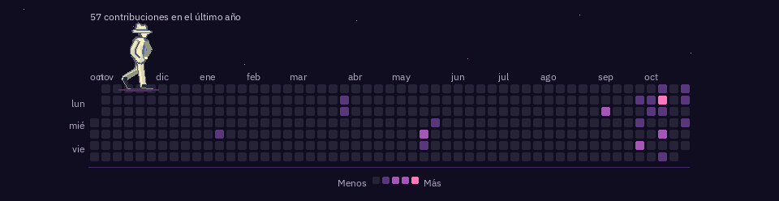

# Moonwalk Contributions

Genera una animación de la cuadrícula de contribuciones de GitHub: un personaje pixel art de traje claro, camisa azul y sombrero hace moonwalk durante todo el recorrido, encendiendo un brillo en cada baldosa al pasar.

> La vista siguiente usa actividad sintética de demostración. Ejecuta el generador con tu usuario para crear imágenes con datos reales.



[Ver imagen estática de respaldo](assets/moonwalk-contributions.png) · [Ver una muestra corta del recorrido](assets/moonwalk-continuous-preview.gif)

## Requisitos

- Python 3.12 o posterior.
- Un token de GitHub en `GITHUB_TOKEN` para consultar la API GraphQL. El programa nunca guarda ni muestra el valor del token.

GitHub requiere autenticación para las solicitudes GraphQL. La colección de contribuciones puede incluir contribuciones privadas si el token tiene el permiso `read:user` y la cuenta permite mostrar esos recuentos. Consulta la [documentación de autenticación GraphQL](https://docs.github.com/en/graphql/guides/forming-calls-with-graphql) y la [referencia de contribuciones](https://docs.github.com/en/graphql/reference/users#contributionscollection).

## Instalación

Desde la raíz de un checkout:

```bash
python3.12 -m venv .venv
source .venv/bin/activate
python -m pip install .
```

## Generar tu animación

Configura el token en el entorno y reemplaza `TU_USUARIO` por el nombre de usuario de GitHub:

```bash
export GITHUB_TOKEN="tu-token"
moonwalk-contributions --username TU_USUARIO --output-dir assets
```

El comando escribe `moonwalk-contributions.gif` y `moonwalk-contributions.png` en el directorio indicado. El GIF muestra moonwalk inicial, moonwalk continuo con brillo y moonwalk final, y se repite en bucle; el PNG muestra la pose final y sirve como alternativa estática. Si la consulta falla, los archivos que ya existían se conservan.

La cuadrícula representa el último año de contribuciones que devuelve GitHub. Las contribuciones privadas dependen de los permisos del token y la configuración de la cuenta.

## Desarrollo

Instala las herramientas de desarrollo y ejecuta los mismos controles que usa CI:

```bash
python -m pip install -e '.[dev]'
ruff check .
ruff format --check .
mypy --strict
pytest
```

El código sigue PEP 8, usa type hints y docstrings en las APIs públicas, y mantiene la consulta, el modelo, el render y la CLI en módulos separados.

Consulta [CONTRIBUTING.md](CONTRIBUTING.md) para preparar y proponer cambios.

## Licencia

Este proyecto se distribuye bajo la licencia MIT. Consulta el archivo [LICENSE](LICENSE).

## Actualización automática en GitHub Actions

El workflow `Update contributions animation` valida el paquete y actualiza los recursos diariamente. También puedes iniciarlo desde **Actions → Update contributions animation → Run workflow**.

Configura la variable de repositorio `GITHUB_USERNAME` con la cuenta que alimentará la animación. Al ejecutarlo manualmente, puedes indicar otro usuario en el campo `username`.

GraphQL requiere autenticación. El workflow usa el secreto `CONTRIBUTIONS_TOKEN` si está configurado; para contribuciones públicas también puede usar el `GITHUB_TOKEN` automático. Para incluir contribuciones privadas, crea un token con permiso `read:user` y guárdalo como `CONTRIBUTIONS_TOKEN` en **Settings → Secrets and variables → Actions**. No pegues el token en variables, archivos ni comandos registrados.

El workflow solo agrega los dos archivos generados en `assets/` y crea un commit cuando cambian. Si la consulta o la generación falla, termina con error y conserva los recursos publicados anteriormente.
